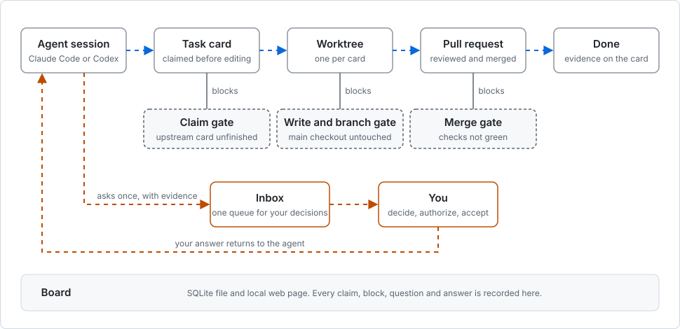

# nawaban

**English** | [简体中文](README.zh-CN.md)

**A local task board that Claude Code and Codex sessions share with you, so several agents can work in one repository without overwriting each other.**

Each agent claims a task card before it edits, works in its own Git worktree, and puts the questions only you can answer into one inbox. Hooks block the moves that cause collisions: editing the main checkout, switching branches there, and merging a pull request whose checks are not green.


*A demo board: two agents hold three cards, and one card is waiting for a human decision.*

## Architecture


nawaban has five parts. All of them live in this repository and run on your machine.

| Part | Where | What it does |
| --- | --- | --- |
| Skills | `skills/` | Four instruction files the agent reads. `nawaban`: how to claim a card, where to edit and how to hand off. `nawaban-setup`: connect a project to nawaban. `nawaban-wrapup`: check for unfinished cards before a session ends. `nawaban-director`: a director session splits a request into cards and dispatches each to its own worker session. |
| CLI | `nawaban/cli.py` | Python command line. Creating, claiming, linking, asking, handing off and dispatching all go through it, and it enforces the state rules. |
| Database | `.nawaban/nawaban.db` | One SQLite file. It holds task cards, events and decisions, dependencies, inbox questions and worker letters. |
| Board | `nawaban/board_view.py`, `nawaban/webui/` | A local Python server and a React page. It reads every task and writes only two things: your answers and the ideas you capture. |
| Hooks | `hooks/hooks.json` | Attached to Claude Code and Codex. They show the task banner when a session starts, check writes, branch switches and merges before a tool runs, and at the end of each turn check the main checkout and pass messages between a director and its workers. |

## How a task moves



Blue is the path a task takes. Orange is the only path that needs you. The dashed boxes are the gates, and each one stops a specific collision.

## Is it for you?

It fits when:

- You run more than one Claude Code or Codex session on the same repository and need to know who is doing what.
- Your agents work through Git worktrees and pull requests.
- You want agents to queue their questions in one place and keep working on something else.

It does not fit when:

- You run one agent on one task at a time. The cards and worktrees are overhead you will not get back.
- You need a hosted board with accounts. The board is a SQLite file on your machine and a web page served on localhost.
- Your agent is neither Claude Code nor Codex. The gates are hooks for those two tools.
- You need English command output. The CLI messages and the agent skills are written in Chinese; the board UI has both languages.

## Requirements

- Git, Bash and Python 3.9 or newer. The CLI runs from the checkout without installing a package.
- Claude Code or Codex.
- Node.js and npm, used once to build the board UI.

## Quick start

About five minutes. One clone serves as both the plugin and the CLI.

1. Clone the repository and install the plugin in Claude Code. Codex is covered in [docs/install.md](docs/install.md).

   ```sh
   git clone https://github.com/victorGPT/nawaban ~/nawaban
   claude plugin marketplace add ~/nawaban
   claude plugin install nawaban@nawaban
   ```

2. Define the CLI in your shell profile.

   ```sh
   export NAWABAN_HOME=~/nawaban
   nawaban() { python3 "$NAWABAN_HOME/nawaban/cli.py" "$@"; }
   ```

3. Create a board in your project.

   ```console
   $ cd /path/to/your-project
   $ nawaban init
   ✓ init → /path/to/your-project/.nawaban/nawaban.db
   $ nawaban inbox
   没有需要你决定的事(本周进 0 · 已清 0)
   ```

   The last line says nothing is waiting for you.

4. Build the board UI once, then open the board.

   ```sh
   (cd "$NAWABAN_HOME/nawaban/webui" && npm ci && npm run build)
   bash "$NAWABAN_HOME/nawaban/board-up.sh"
   ```

   The script prints the address, `http://127.0.0.1:8813/` by default.

5. Start Claude Code in the project and give it a task. The session opens with a banner listing the active cards, and the `nawaban` skill loads before the agent changes a file.

## What a session looks like

The agent runs these commands itself. They are shown here so you can read the board's history.

An agent creates a card, claims it and starts work:

```console
$ nawaban create DEMO-001 --title "登录页支持邮箱验证码" \
    --context "- 用户要求用验证码代替密码登录" \
    --success '["输入邮箱后收到 6 位验证码并能登录"]' --touch src/login.py
✓ create DEMO-001
$ nawaban claim DEMO-001
✓ claim-check(你=『demo』)· 候选文件无别窗占用。
✓ claim DEMO-001 → demo
$ nawaban start DEMO-001 --now "接入邮件发送"
✓ start DEMO-001
```

A card that depends on unfinished work cannot be claimed:

```console
$ nawaban claim DEMO-003
✗ claim 上游闸:这张卡的 depends_on 上游还没 done ——
   ⏸ DEMO-001(in_progress)
  先做上游;确要强闯:nawaban claim DEMO-003 --override "理由"
```

An agent that needs a decision asks once, with its evidence and the options, and the question reaches your inbox:

```console
$ nawaban inbox
1 件事等你 · 最久 0.0 天(本周进 1 · 已清 0)

━━ 拍板 · 1
  #1    0.0d  导出 CSV 要不要包含已作废的账单？
        挂 1 张: DEMO-004
```

You answer in the board's inbox or with `nawaban answer`. `nawaban --help` lists every command.

<!-- Anchor linked from skills/nawaban-setup and skills/nawaban/references/runtime.md. -->
## Install as a plugin

The same checkout is a Claude Code plugin and a Codex plugin. The Claude Code commands are in step 1 above; update later with `claude plugin update nawaban@nawaban`.

[docs/install.md](docs/install.md) has the Codex configuration, the hook trust prompt, what each gate inspects in each tool, and how to run the CLI without installing a plugin.

## Documentation

| Topic | Page |
| --- | --- |
| Codex setup, gates, hook trust, session identity | [docs/install.md](docs/install.md) |
| Several repositories on one board, task context format, board filters and display | [docs/board.md](docs/board.md) |
| Optional module and prerequisite hints on `create` | [docs/hints.md](docs/hints.md) |
| Capturing ideas that are not tasks yet | [docs/capture.md](docs/capture.md) |
| Inactivity markers on cards | [docs/task-staleness.md](docs/task-staleness.md) |
| Product vocabulary, in English and Chinese | [CONTEXT.md](CONTEXT.md) |
| Repository layout and running the tests | [docs/development.md](docs/development.md) |
| Release notes and legacy configuration | [CHANGELOG.md](CHANGELOG.md) |

## The name

縄 (nawa, rope) and 板 (ban, board). Before a building rises, the foreman stretches ropes on bare ground to mark where the walls will go. nawaban is the board where those lines get drawn. 在万物构筑之前，先拉绳定界。

## License

[MIT](LICENSE)
