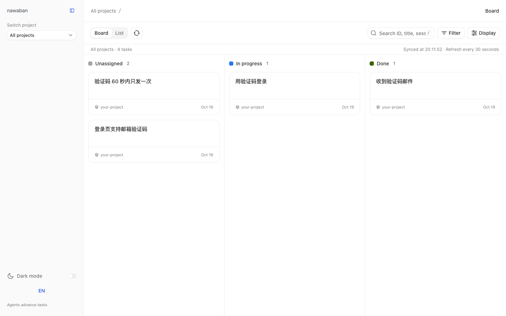
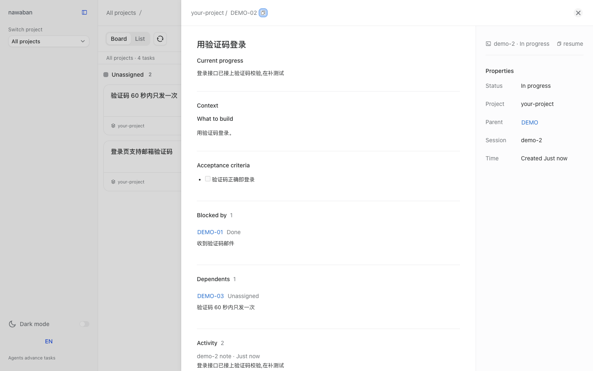

# nawaban

**English** | [简体中文](README.zh-CN.md)

**A local task tracker that Claude Code and Codex sessions share with you: every task of every project on one board, with the notes, decisions and links that show how it got done.**

Your agents publish a spec, split it into tasks, claim the ones that are ready and record what they decide along the way. You watch it on a board in your browser, and the agents only stop to ask you about the things that are yours to decide.



*A demo board: a spec and three tasks. One task is done, one is in progress, and one waits for the task it is blocked by.*

## Architecture

[](https://victorgpt.github.io/nawaban/diagrams/architecture.html)

*Click the diagram for the interactive version.*

nawaban has four parts. All of them live in this repository and run on your machine. Nothing hooks into your sessions and no command blocks a tool call.

| Part | Where | What it does |
| --- | --- | --- |
| Skill | `skills/nawaban/` | One instruction file the agent reads: how to publish a spec and its tasks, find the frontier, claim a task, record notes, decisions and links, and close it. It also carries three rules: ask the user only about product behaviour, outside statements and production releases; record every choice as a decision; claim before working. |
| CLI | `nawaban/cli.py` | Python command line. Every write to the board goes through it. |
| Board file | `.nawaban/nawaban.db` | One SQLite file holding tasks and their events. |
| Board | `nawaban/board_view.py`, `nawaban/webui/` | A local Python server and a React page that show the board and each task's detail. It only reads. |

## How a task moves

[](https://victorgpt.github.io/nawaban/diagrams/flow.html)

Blue is the path every task takes. Orange is the only path that needs you: the agent asks you in the conversation about how the product should behave, what is said to the outside, or whether something goes to production, and records your answer as a decision.

## Is it for you?

It fits when:

- You run several Claude Code or Codex sessions, across one or more repositories, and want to see who is doing what.
- Your agents follow a spec → tasks → implementation workflow and need a place to record it.
- You want to read later why something was built the way it was.

It does not fit when:

- You run one agent on one small task at a time. A chat history is enough.
- You need a hosted board with accounts. The board is a SQLite file on your machine and a web page served on localhost.
- You need English command output. The CLI messages are written in Chinese; the board UI has both languages.

## Requirements

- Git, Bash and Python 3.9 or newer.
- Claude Code or Codex.

## Quick start

In the project that should get a board, paste this into Claude Code or Codex:

```text
Install nawaban by following https://github.com/victorGPT/nawaban/blob/main/docs/install.md and create a board in this project.
```

The agent clones nawaban to `~/nawaban`, installs the plugin, creates the board and starts it, then gives you the board address, `http://127.0.0.1:8813/` by default. Start a new session afterwards so the `nawaban` skill loads.

To do it by hand, [docs/install.md](docs/install.md) has the same steps.

## What a session looks like

The agent runs these commands itself. They are shown here so you can read the board's history. `nawaban` stands for `python3 ~/nawaban/nawaban/cli.py`.

A spec is published with its tasks; the second task is blocked by the first, so only the first is on the frontier:

```console
$ nawaban create DEMO --title "登录页支持邮箱验证码" --body-file spec.md
✓ create DEMO · 项目 your-project
$ nawaban create DEMO-01 --title "收到验证码邮件" --parent DEMO --body-file t1.md
✓ create DEMO-01 · 项目 your-project
$ nawaban create DEMO-02 --title "用验证码登录" --parent DEMO --body-file t2.md --blocked-by DEMO-01
✓ create DEMO-02 · 项目 your-project
$ nawaban list --parent DEMO --frontier
DEMO-01  open  your-project  收到验证码邮件
```

A session claims the ready task. Another session trying the same task is told who holds it:

```console
$ nawaban claim DEMO-01
✓ claim DEMO-01 · 窗口 demo
$ nawaban claim DEMO-01
✗ DEMO-01 在窗口 demo 手上;确要接手加 --take
```

It records your answer to a question as a decision, links the pull request and closes the task, which puts `DEMO-02` on the frontier:

```console
$ nawaban event DEMO-01 --kind decision --by user --body "Question: 验证码有效期多长?
Verdict: 10 分钟"
✓ event DEMO-01 · decision
$ nawaban event DEMO-01 --kind link --body "pr:https://github.com/you/app/pull/12"
✓ event DEMO-01 · link
$ nawaban close DEMO-01 --done
✓ close DEMO-01 → done
$ nawaban list --parent DEMO --frontier
DEMO-02  open  your-project  用验证码登录
```

On the board, each task opens to its body, its progress, what it is blocked by, what waits on it, and its events:



`nawaban show <id>` prints the same in the terminal. `nawaban --help` lists every command.

<!-- Anchor linked from docs/install.md. -->
## Install as a plugin

The same checkout is a Claude Code plugin and a Codex plugin; it ships one skill and no hooks. The quick start installs it for you. [docs/install.md](docs/install.md) has the manual steps, the GitHub install, the Codex configuration, session identity, and how to run the CLI without installing a plugin.

## Documentation

| Topic | Page |
| --- | --- |
| GitHub and Codex install, session identity, running from a checkout | [docs/install.md](docs/install.md) |
| Several repositories on one board, board filters and display | [docs/board.md](docs/board.md) |
| Inactivity colours on cards | [docs/task-staleness.md](docs/task-staleness.md) |
| Product vocabulary, in English and Chinese | [GLOSSARY.md](GLOSSARY.md) |
| Repository layout and running the tests | [docs/development.md](docs/development.md) |
| Release notes and legacy configuration | [CHANGELOG.md](CHANGELOG.md) |

## The name

縄 (nawa, rope) and 板 (ban, board). Before a building rises, the foreman stretches ropes on bare ground to mark where the walls will go. nawaban is the board where those lines get drawn. 在万物构筑之前，先拉绳定界。

## License

[MIT](LICENSE)
