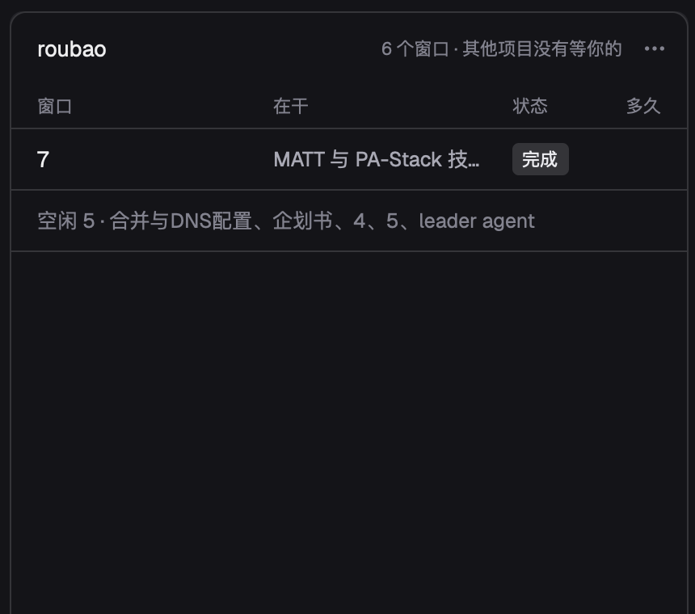

# nawaban

**A local task tracker for Claude Code and Codex sessions: tasks, plus an append-only log of the notes, decisions and links that show how each one got done.**

Your agents publish a spec, split it into tasks, claim the ones that are ready and record what they decide along the way. Everything lives in one SQLite file on your machine. You watch it in a panel beside your terminals, and the agents only stop to ask you what is yours to decide.

nawaban has three parts:

- **CLI** (`nawaban/cli.py`): a Python command line; every read and write of the board goes through it. Its messages are in Chinese.
- **Skill** (`skills/nawaban/`): one instruction file that tells an agent how to publish a spec and its tasks, find the tasks ready to start, claim one, record notes, decisions and links, and close it.
- **Herdr panel** (`herdr/mods/nawaban-board/`): a read-only view of the board in the [Herdr](https://herdr.dev) app.

The checkout installs as a Claude Code plugin or a Codex plugin. It ships the one skill and registers no hooks.

## See it in Herdr



The panel lists the windows of the current space, joined with the board: a card for each window waiting on you, with its question, then a table of what the others are doing (停了, 完成, 在干), and the idle ones in one row. A window is waiting on you when its agent needs you to answer or act. A click on a card or row goes to that window. Its labels are in Chinese, or English.

## Install

Requirements: Git and Python 3.9 or newer, Claude Code or Codex, and the Herdr app for the panel.

In the project that should get a board, paste this into Claude Code or Codex:

```text
Install nawaban by following https://github.com/victorGPT/nawaban/blob/main/docs/install.md and create a board in this project.
```

The agent clones nawaban to `~/nawaban`, installs the plugin and creates the board. Start a new session afterwards so the `nawaban` skill loads. [docs/install.md](docs/install.md) has the same steps by hand, the Codex setup and how to add the panel to a Herdr layout.

## More

- [GLOSSARY.md](GLOSSARY.md): what task, frontier, claim, decision and the other terms mean.
- [docs/development.md](docs/development.md): repository layout and running the tests.

縄 (nawa, rope) and 板 (ban, board): before a building rises, ropes on bare ground mark where the walls will go.

## License

[MIT](LICENSE)
