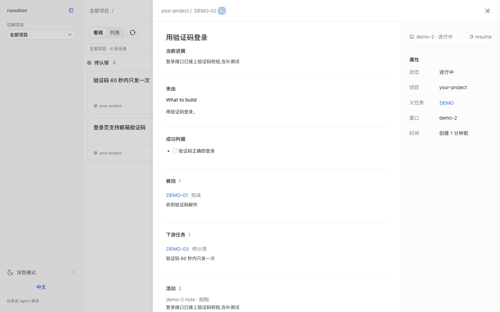

# nawaban

[English](README.md) | **简体中文**

**一个本地任务记录工具，Claude Code 和 Codex 的会话与你共用：所有项目的所有任务都在一块看板上，连同说明它怎么做完的笔记、决定和链接。**

你的 agent 发布 spec、拆成任务、认领可以开工的任务，并把一路上做的决定记下来。你在浏览器里的看板上看着这一切；agent 只在该你拍板的事情上停下来问你。


*演示看板：一份 spec 和三个任务。一个已完成，一个进行中，还有一个在等它的前置任务。*

## 架构

[](https://victorgpt.github.io/nawaban/diagrams/architecture.zh-CN.html)

*点开图可以看交互版。*

nawaban 由四部分组成，全部在这一个仓库里，运行在你自己的机器上。它不在你的会话里挂任何 hook，也没有命令会拦住工具调用。

| 部分 | 位置 | 做什么 |
| --- | --- | --- |
| Skill | `skills/nawaban/` | 一份给 agent 读的操作说明：怎么发布 spec 和拆出的任务、找可开工的任务、认领、记笔记/决定/链接、关闭。另带三条规则：只拿产品行为、对外说法、上不上生产这三类问题问用户；每次在选项之间做选择都记成决定；动手前先认领。 |
| CLI | `nawaban/cli.py` | Python 命令行。对看板的每次写入都经过它。 |
| 看板文件 | `.nawaban/nawaban.db` | 一个 SQLite 文件，存任务和它们的事件。 |
| 看板 | `nawaban/board_view.py`、`nawaban/webui/` | Python 写的本地服务，加一个 React 网页，显示看板和每个任务的详情。只读。 |

## 任务怎么流转

[](https://victorgpt.github.io/nawaban/diagrams/flow.zh-CN.html)

蓝色是每个任务都会走的路径。橙色是唯一需要你的路径：agent 在对话里问你产品该怎么表现、对外怎么说、要不要上生产，再把你的回答记成一条决定。

## 适不适合你

适合：

- 你在一个或多个仓库里同时开着多个 Claude Code 或 Codex 会话，想知道谁在做什么。
- 你的 agent 按 spec → 拆任务 → 实现的流程干活，需要一个地方记下来。
- 你想事后查得到某样东西为什么是这样做的。

不适合：

- 你一次只让一个 agent 做一件小事。聊天记录就够了。
- 你需要带账号的托管看板。这块看板是你机器上的一个 SQLite 文件，加一个在 localhost 提供的网页。
- 你需要英文的命令输出。CLI 的提示是中文的；看板界面有中英两种语言。

## 前置条件

- Git、Bash、Python 3.9 或更高版本。CLI 直接从仓库目录运行，不用安装包。
- Claude Code 或 Codex。
- Node.js 和 npm，只在构建看板界面时用一次。

## 快速上手

大约五分钟。同一份克隆既是插件，也是 CLI。

1. 克隆仓库，在 Claude Code 里安装插件。Codex 的装法见 [docs/install.md](docs/install.md)。

   ```sh
   git clone https://github.com/victorGPT/nawaban ~/nawaban
   claude plugin marketplace add ~/nawaban
   claude plugin install nawaban@nawaban
   ```

2. 在 shell 配置文件里定义 CLI。

   ```sh
   export NAWABAN_HOME=~/nawaban
   nawaban() { python3 "$NAWABAN_HOME/nawaban/cli.py" "$@"; }
   ```

3. 在你的项目里建一块看板。

   ```console
   $ cd /path/to/your-project
   $ nawaban init
   ✓ init → /path/to/your-project/.nawaban/nawaban.db
   ```

4. 构建一次看板界面，然后打开看板。

   ```sh
   (cd "$NAWABAN_HOME/nawaban/webui" && npm ci && npm run build)
   bash "$NAWABAN_HOME/nawaban/board-up.sh"
   ```

   脚本会打印访问地址，默认是 `http://127.0.0.1:8813/`。

5. 在项目里启动 Claude Code，给它派一个任务。某个 skill 发布或读取任务时，或 agent 动手做一个任务之前，会加载 `nawaban` skill。

## 一次会话长什么样

下面这些命令由 agent 自己执行。放在这里是为了让你看得懂看板上的记录。

发布一份 spec 和拆出的任务；第二个任务的前置任务是第一个，所以只有第一个可以开工：

```console
$ nawaban create DEMO --title "登录页支持邮箱验证码" --body-file spec.md
✓ create DEMO · 项目 your-project
$ nawaban create DEMO-01 --title "收到验证码邮件" --parent DEMO --body-file t1.md
✓ create DEMO-01 · 项目 your-project
$ nawaban create DEMO-02 --title "用验证码登录" --parent DEMO --body-file t2.md --blocked-by DEMO-01
✓ create DEMO-02 · 项目 your-project
$ nawaban list --parent DEMO --frontier
DEMO-01  open  your-project  收到验证码邮件
```

一个窗口认领可开工的任务。另一个窗口再认领同一个任务时，会被告知谁拿着它：

```console
$ nawaban claim DEMO-01
✓ claim DEMO-01 · 窗口 demo
$ nawaban claim DEMO-01
✗ DEMO-01 在窗口 demo 手上;确要接手加 --take
```

它把你对一个问题的回答记成决定，挂上 PR 链接，然后关闭任务，`DEMO-02` 随之可以开工：

```console
$ nawaban event DEMO-01 --kind decision --by user --body "Question: 验证码有效期多长?
Verdict: 10 分钟"
✓ event DEMO-01 · decision
$ nawaban event DEMO-01 --kind link --body "pr:https://github.com/you/app/pull/12"
✓ event DEMO-01 · link
$ nawaban close DEMO-01 --done
✓ close DEMO-01 → done
$ nawaban list --parent DEMO --frontier
DEMO-02  open  your-project  用验证码登录
```

在看板上点开一个任务，能看到它的正文、当前进展、前置任务、在等它的任务，以及它的事件：



终端里用 `nawaban show <id>` 看到的是同样的内容。全部命令见 `nawaban --help`。

## 作为插件安装

同一份克隆既是 Claude Code 插件，也是 Codex 插件；它只带一份 skill，不带 hook。Claude Code 的命令在上面第 1 步。从 GitHub 安装、Codex 的配置、会话身份、不装插件怎么直接运行 CLI，都在 [docs/install.md](docs/install.md)。

## 文档

除术语表外，下列页面目前是英文。

| 主题 | 页面 |
| --- | --- |
| 从 GitHub 安装、Codex 配置、会话身份、从克隆直接运行 | [docs/install.md](docs/install.md) |
| 多个仓库共用一块看板、看板筛选与显示 | [docs/board.md](docs/board.md) |
| 卡片上的久未更新颜色 | [docs/task-staleness.md](docs/task-staleness.md) |
| 产品术语表（中英对照） | [GLOSSARY.md](GLOSSARY.md) |
| 仓库结构与运行测试 | [docs/development.md](docs/development.md) |
| 发布说明与旧配置的兼容 | [CHANGELOG.md](CHANGELOG.md) |

## 名字

「縄」(nawa，绳)和「板」(ban，看板的板)。盖房子之前，工头先在空地上拉绳，标出墙要落在哪里。nawaban 就是画这些线的那块板。在万物构筑之前，先拉绳定界。

## 许可证

[MIT](LICENSE)
