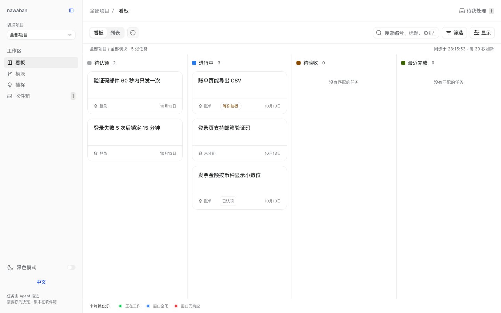
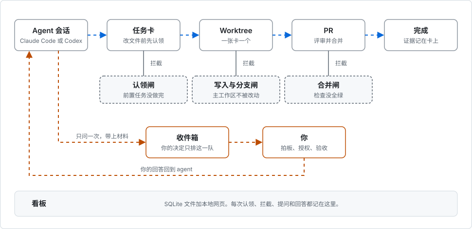

# nawaban

[English](README.md) | **简体中文**

**一块本地任务看板，Claude Code 和 Codex 的多个会话与你共用，让几个 agent 在同一个仓库里干活而不互相覆盖。**

每个 agent 改文件前先认领一张任务卡，在自己的 Git worktree 里干活，只有你能回答的问题统一放进一个收件箱。hook 会拦住三种容易撞车的动作：改主工作区的文件、在主工作区切分支、合并检查没全绿的 PR。



*演示看板：两个 agent 持有三张卡，其中一张在等人拍板。*

## 架构



nawaban 由五部分组成，全部在这一个仓库里，运行在你自己的机器上。

| 部分 | 位置 | 做什么 |
| --- | --- | --- |
| Skill | `skills/` | 四份给 agent 读的操作说明。`nawaban`：改文件前怎么认领、在哪个工位改、怎么交接。`nawaban-setup`：把一个项目接入 nawaban。`nawaban-wrapup`：会话结束前检查没收尾的卡。`nawaban-director`：主控会话把需求拆成卡，派给独立的 worker 会话。 |
| CLI | `nawaban/cli.py` | Python 命令行。建卡、认领、连依赖、提问、记交接、派 worker，所有对任务的写入都经过它，状态规则也在这里检查。 |
| 数据库 | `.nawaban/nawaban.db` | 一个 SQLite 文件。存任务卡、事件与决定、依赖关系、收件箱提问和 worker 来信。 |
| 看板 | `nawaban/board_view.py`、`nawaban/webui/` | Python 写的本地服务，加一个 React 网页。读出全部任务；只写两样东西：你的回答和你捕捉的想法。 |
| Hook | `hooks/hooks.json` | 挂在 Claude Code 和 Codex 上。会话开始时显示任务横幅；工具调用前检查写入、切分支和合并；每轮结束时检查主工作区，并在主控和 worker 之间传话。 |

## 一个任务怎么走



蓝色是一个任务走的路。橙色是唯一需要你的那条路。虚线框是闸门，每一道拦一种具体的撞车。

## 适不适合你

适合：

- 你在同一个仓库里同时开着多个 Claude Code 或 Codex 会话，需要知道谁在做什么。
- 你的 agent 通过 Git worktree 和 PR 交付。
- 你希望 agent 把问题集中排到一处，然后继续做别的。

不适合：

- 你一次只让一个 agent 做一件事。任务卡和 worktree 是额外负担，换不回收益。
- 你需要带账号的托管看板。这块看板是你机器上的一个 SQLite 文件，加一个在 localhost 提供的网页。
- 你用的 agent 既不是 Claude Code 也不是 Codex。闸门是为这两个工具写的 hook。
- 你需要英文的命令输出。CLI 的提示和 agent skill 是中文的；看板界面有中英两种语言。

## 前置条件

- Git、Bash、Python 3.9 或更高版本。CLI 直接从仓库目录运行，不用安装包。
- Claude Code 或 Codex。
- Node.js 和 npm，只在构建看板界面时用一次。

## 快速上手

大约五分钟。同一份克隆既是插件，也是 CLI。

1. 克隆仓库，在 Claude Code 里安装插件。Codex 的装法见 [docs/install.md](docs/install.md)。

   ```sh
   git clone https://github.com/victorGPT/nawaban ~/nawaban
   claude plugin marketplace add ~/nawaban
   claude plugin install nawaban@nawaban
   ```

2. 在 shell 配置文件里定义 CLI。

   ```sh
   export NAWABAN_HOME=~/nawaban
   nawaban() { python3 "$NAWABAN_HOME/nawaban/cli.py" "$@"; }
   ```

3. 在你的项目里建一块看板。

   ```console
   $ cd /path/to/your-project
   $ nawaban init
   ✓ init → /path/to/your-project/.nawaban/nawaban.db
   $ nawaban inbox
   没有需要你决定的事(本周进 0 · 已清 0)
   ```

4. 构建一次看板界面，然后打开看板。

   ```sh
   (cd "$NAWABAN_HOME/nawaban/webui" && npm ci && npm run build)
   bash "$NAWABAN_HOME/nawaban/board-up.sh"
   ```

   脚本会打印访问地址，默认是 `http://127.0.0.1:8813/`。

5. 在项目里启动 Claude Code，给它派一个任务。会话开头会显示一段横幅，列出进行中的任务卡；agent 改文件之前会先加载 `nawaban` skill。

## 一次会话长什么样

下面这些命令由 agent 自己执行。放在这里是为了让你看得懂看板上的记录。

agent 建卡、认领、开工：

```console
$ nawaban create DEMO-001 --title "登录页支持邮箱验证码" \
    --context "- 用户要求用验证码代替密码登录" \
    --success '["输入邮箱后收到 6 位验证码并能登录"]' --touch src/login.py
✓ create DEMO-001
$ nawaban claim DEMO-001
✓ claim-check(你=『demo』)· 候选文件无别窗占用。
✓ claim DEMO-001 → demo
$ nawaban start DEMO-001 --now "接入邮件发送"
✓ start DEMO-001
```

前置任务没做完的卡认领不了：

```console
$ nawaban claim DEMO-003
✗ claim 上游闸:这张卡的 depends_on 上游还没 done ——
   ⏸ DEMO-001(in_progress)
  先做上游;确要强闯:nawaban claim DEMO-003 --override "理由"
```

agent 需要你做决定时只问一次，带上材料和选项，问题会出现在你的收件箱里：

```console
$ nawaban inbox
1 件事等你 · 最久 0.0 天(本周进 1 · 已清 0)

━━ 拍板 · 1
  #1    0.0d  导出 CSV 要不要包含已作废的账单？
        挂 1 张: DEMO-004
```

你可以在看板的收件箱里回答，也可以用 `nawaban answer`。全部命令见 `nawaban --help`。

## 作为插件安装

同一份克隆既是 Claude Code 插件，也是 Codex 插件。Claude Code 的命令在上面第 1 步；以后更新用 `claude plugin update nawaban@nawaban`。

Codex 的配置、hook 信任提示、每道闸在两个工具里各检查什么、不装插件怎么直接运行 CLI，都在 [docs/install.md](docs/install.md)。

## 文档

除「捕捉想法」外，下列页面目前是英文。

| 主题 | 页面 |
| --- | --- |
| Codex 配置、闸门、hook 信任、会话身份 | [docs/install.md](docs/install.md) |
| 多个仓库共用一块看板、任务背景的格式、看板筛选与显示 | [docs/board.md](docs/board.md) |
| 建卡时可选的模块提示和前置任务提示 | [docs/hints.md](docs/hints.md) |
| 捕捉还不是任务的想法 | [docs/capture.md](docs/capture.md) |
| 任务卡上的不活跃标记 | [docs/task-staleness.md](docs/task-staleness.md) |
| 产品术语表（中英对照） | [CONTEXT.md](CONTEXT.md) |
| 仓库结构与运行测试 | [docs/development.md](docs/development.md) |
| 发布说明与旧配置的兼容 | [CHANGELOG.md](CHANGELOG.md) |

## 名字

「縄」(nawa，绳)和「板」(ban，看板的板)。盖房子之前，工头先在空地上拉绳，标出墙要落在哪里。nawaban 就是画这些线的那块板。在万物构筑之前，先拉绳定界。

## 许可证

[MIT](LICENSE)
