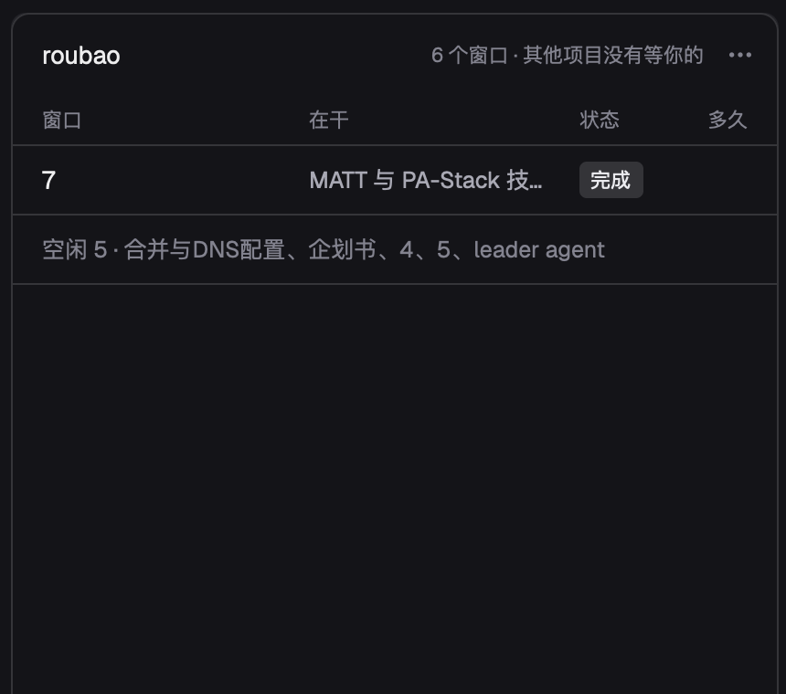

# Installation

## Without Herdr: one command (macOS)

For someone who wants the board and its web page, with Claude Code and without Herdr.

Before you start, have:

- macOS (the board runs as a launchd agent).
- Node 22.18 or later (`node -v`) and pnpm (`npm install -g pnpm`).
- Claude Code, logged in (`claude` works in a terminal).
- git.

Then run:

```sh
git clone https://github.com/victorGPT/nawaban ~/.nawaban/plugin && ~/.nawaban/plugin/install.sh
```

`install.sh` installs the board's packages and builds the web page, installs the Claude Code plugin `nawaban@nawaban` from that checkout, writes the `nawaban` command to `~/.local/bin`, opens Codex's sandbox to the board when `codex` is on your `PATH` ([Codex sandbox](#codex-sandbox)), and starts the board as the launchd agent `com.nawaban.board` on `127.0.0.1:4100`, which writes the board's token and the page's token into `~/.nawaban/board/` on first start. It stops and says why when a prerequisite is missing. If `~/.local/bin` is not on your `PATH`, it tells you the line to add. To update later, run `git -C ~/.nawaban/plugin pull --ff-only && ~/.nawaban/plugin/install.sh`; running it again is safe.

`NAWABAN_BOARD_DIR`, `NAWABAN_BOARD_PORT`, `NAWABAN_LAUNCHD_LABEL` and `NAWABAN_BIN_DIR` change where it puts the board, the port, the agent's label and the command, for a trial install beside an existing one. The `nawaban` command and the agent keep them, but the plugin's hooks read them from the environment Claude Code runs in, so start Claude Code with the same `NAWABAN_BOARD_DIR` and `NAWABAN_BOARD_PORT`; a normal install leaves them unset.

Every repository you work in uses this board, under its main checkout's name. `node ~/.nawaban/plugin/hooks/route.mjs` in a repository prints `board <project>`.

### First use

1. **Declare the orchestrator.** In your project, start a new Claude Code session and type `/nawaban:orchestrator`. It answers `已把会话 … 记为 <project> 的编排者（没有 Herdr，按会话认）`, prints the project's index, and records the repository in `~/.nawaban/board/repos.json` so the page's OKR tab finds its `docs/agents/okr.toml`. A new session or `/clear` needs the declaration again.
2. **Open the page.** Run `nawaban web`. The browser opens `http://127.0.0.1:4100/` with the page's token in the link; the page shows your projects' 待决, OKR, 任务 and 收件箱.
3. **Answer a 待决.** When the orchestrator asks you to decide, the card shows under 待决. Pick an option, add your words and send it. The task stays held until the orchestrator records your answer: on its next prompt it sees `## 网页已答`, and the line after each reply reads `待决 1 件，网页已答 1 件`.
4. **Note something in the 收件箱.** Type an idea under 收件箱 and keep it. The orchestrator sees it as `## 收件箱` and makes it a task, runs it, or drops it; a task made from it shows its key there.

If the page answers `401` or says to build, run `nawaban web` again, or rerun `install.sh`. The board's log is `~/.nawaban/board/serve.log`; restart it with `launchctl kickstart -k gui/$(id -u)/com.nawaban.board`.

## With Herdr

The short path: paste this into Claude Code or Codex, in the project that should get a board.

```text
Install nawaban by following https://github.com/victorGPT/nawaban/blob/main/docs/install.md and create a board in this project.
```

The agent follows the next section. The sections after it are the same install by hand, and the details behind it.

## For the agent doing the install

Run these steps in order. Each one is safe to run again. Stop and tell the user if a step fails.

1. Check that `git`, `pnpm` and `node` exist and that `node --version` is 22.18 or newer.
2. Put nawaban at `~/nawaban`. If that directory exists and is a nawaban checkout, run `git -C ~/nawaban pull --ff-only`; otherwise run `git clone https://github.com/victorGPT/nawaban ~/nawaban`.
3. Install the plugin.
   - Claude Code: `claude plugin marketplace add ~/nawaban`, then `claude plugin install nawaban@nawaban`.
   - Codex: add the marketplace and plugin entries shown under [Plugin install](#plugin-install) to `~/.codex/config.toml` with `source = "<absolute path of ~/nawaban>"`, then run `codex plugin add nawaban@nawaban`. Open its sandbox to the board as [Codex sandbox](#codex-sandbox) says. Codex sessions are identified by `CODEX_THREAD_ID` ([Session identity](#session-identity)).
   - Antigravity: run the three commands under [Plugin install](#plugin-install) with `~/nawaban`, and add the allow rule from [Antigravity permissions](#antigravity-permissions).
4. Install the board's packages: `pnpm --dir ~/nawaban/board install --frozen-lockfile`. The board lives in `~/.nawaban/board/`; `nawaban serve` (or `install.sh`) keeps it running.
5. Tell the user three things: the board path from step 4, that the `nawaban` skill loads in a new session, so they should start one, and that they see the board in the Herdr panel, which they install by following [Herdr panel](#herdr-panel).

Optional, for a person who wants to type commands: add `nawaban() { node ~/nawaban/board/src/cli.ts "$@"; }` to their shell profile, only if they ask.

## Plugin install

The same checkout is a Claude Code plugin, a Codex plugin and an Antigravity plugin. It ships three skills, `nawaban`, `orchestrator` and `collaboration`, and `hooks/hooks.json` registers SessionStart, UserPromptSubmit, PreToolUse, PostToolUse and Stop hooks that keep the orchestrator's declaration, pending line and ask guard. Claude Code runs them once the plugin is installed. Codex runs them only after you trust each one in `/hooks`, and again after any change to the file; untrusted, they stay off and the orchestrator falls back to running `nawaban page` itself. Antigravity reads a plugin's hooks only from the `hooks.json` at its root. That file hands each event to `hooks/agy.mjs`, which runs the same scripts and translates their input and output. It runs them with `node`, and when `node` is not on the `PATH` Antigravity runs hooks with, every command the agent runs is denied.

- **Claude Code:** `claude plugin marketplace add /path/to/nawaban`, then `claude plugin install nawaban@nawaban`. For a one-off session, `claude --plugin-dir /path/to/nawaban` also works. With this directory marketplace, Claude Code reads the plugin from the checkout; start a new session after pulling. If you also develop nawaban, point the marketplace at a separate clone that only follows `main`, so branch switches and uncommitted edits stay out of your sessions ([release and update](release.md)).
- **From GitHub:** `claude plugin marketplace add victorGPT/nawaban`, then `claude plugin install nawaban@nawaban`. Claude Code updates the plugin only when `version` in `.claude-plugin/plugin.json` changes: run `claude plugin marketplace update nawaban && claude plugin update nawaban@nawaban`, then start a new session ([release and update](release.md)).
- **Codex:** add the checkout as a local marketplace in `~/.codex/config.toml`, then install it. Codex copies the plugin into its cache, so run `codex plugin add` again after pulling.

  ```toml
  [marketplaces.nawaban]
  source_type = "local"
  source = "/path/to/nawaban"

  [plugins."nawaban@nawaban"]
  enabled = true
  ```

  ```sh
  codex plugin add nawaban@nawaban
  ```

- **Antigravity:** `agy plugin install` copies the checkout into `~/.gemini/config/plugins/nawaban` and loads the skills as `/nawaban:nawaban` and `/nawaban:orchestrator`. The copy turns pnpm's links under `board/node_modules` into plain directories, and the board CLI then fails with `Cannot find package 'zod'`, so rebuild them inside the copy. Run the three again after pulling; `install` replaces the earlier copy.

  ```sh
  agy plugin install /path/to/nawaban
  rm -rf ~/.gemini/config/plugins/nawaban/board/node_modules
  pnpm --dir ~/.gemini/config/plugins/nawaban/board install --frozen-lockfile
  ```

### Codex sandbox

Codex's default sandbox, `workspace-write`, has no network and writes only inside the workspace. The board CLI then cannot reach the board (`the board didn't answer: fetch failed`), and `claim` lands on the board but exits 1 with `EPERM`, because it writes its lease under `~/.config/board/claims/` (`$XDG_CONFIG_HOME/board` when that is set), and renewing the claim reads that file. Two settings in `~/.codex/config.toml` (`$CODEX_HOME/config.toml`) fix both:

```toml
[sandbox_workspace_write]
network_access = true
writable_roots = ["/Users/<you>/.config/board"]
```

`writable_roots` takes an absolute path. `install.sh` runs `node ~/.nawaban/plugin/board/src/codex.ts` when `codex` is on your `PATH`: it creates the lease directory and appends this table to a config that has none. A config that already has a `[sandbox_workspace_write]` table is left alone, and the script prints the two lines that table should read. This widens the sandbox: commands Codex runs can reach the network and write that directory.

### Antigravity permissions

Antigravity runs each command in its terminal sandbox first, which has no network, so the board CLI fails there with `the board didn't answer: fetch failed`, and the agent runs it again outside the sandbox. In `agy -p` that second run needs a permission it cannot ask for, and without a rule it is denied. Add the rule to `~/.gemini/antigravity-cli/settings.json`:

```json
{
  "permissions": {
    "allow": ["command(node)"]
  }
}
```

This lets Antigravity run any `node` command outside its sandbox without asking.

For a local checkout, clone `https://github.com/victorGPT/nawaban` and replace `/path/to/nawaban` with its absolute path. Private repositories require GitHub access.

## Run from a checkout

Set `NAWABAN_HOME` to this checkout, run `pnpm --dir "$NAWABAN_HOME/board" install --frozen-lockfile`, and define the CLI in your shell:

```sh
export NAWABAN_HOME="$(pwd)"
nawaban() { node "$NAWABAN_HOME/board/src/cli.ts" "$@"; }
```

Then `nawaban list`. The CLI talks to the board `nawaban serve` keeps in `NAWABAN_BOARD_DIR` (default `~/.nawaban/board/`); every project shares it. `nawaban backup` copies its `local.db` into `backups/` beside it.

## Session identity

Commands that write as someone (`claim`, `close`, `event`) take the identity from `CODEX_THREAD_ID`, which Codex sets in every command it runs, then from `ANTIGRAVITY_CONVERSATION_ID`, which Antigravity sets in every command it runs, then from `CLAUDE_CODE_SESSION_ID`, which Claude Code sets in every session, then from `NAWABAN_OWNER`. Codex and Antigravity come first because a session started from Claude Code inherits `CLAUDE_CODE_SESSION_ID`. Elsewhere, set `NAWABAN_OWNER` to a stable name; without any of the four (a launchd or cron job, say) they write as the OS user, the same person `nawaban serve` hands its token to.

An orchestrator reads `nawaban status` when it starts or after its context is compacted: what waits on you, what stopped, what moves.

## Herdr panel

The [Herdr](https://herdr.dev) app can show the board as a panel beside your terminals; it never writes the board, and on GitHub projects it hands your answers to a pending decision to the repository's orchestrator. It shows what waits on your decision in the focused space, the OKR reading, and the tasks on the board of the project that space is in, grouped by state; it runs `node ~/nawaban/board/src/cli.ts json ...` in the space's folder, which needs Node 22.18 or later and `pnpm install` in `~/nawaban/board`. So it needs the checkout at `~/nawaban` (step 2 above).

1. Copy the mod into Herdr. Copy rather than symlink: Herdr does not reload a symlinked mod when it changes. Run the same command again after pulling to update it.

   ```sh
   cp -R ~/nawaban/herdr/mods/nawaban-board ~/.config/herdr-app/mods/
   herdr-app check ~/.config/herdr-app/mods/nawaban-board
   ```

   The mod has `"place": "none"`: it is not docked anywhere by itself. It opens in any layout as a window (`mod.open:nawaban-board`), which you can drag, that remembers where you dropped it and comes back on the next start until you close it with its ✕. Bind that in the `global` section of `~/.config/herdr-app/keys.json`:

   ```json
   "global": {
     "cmd-shift-j": "mod.open:nawaban-board"
   }
   ```

   To dock it in a layout instead, do steps 2 and 3; that layout's binding wins over the global one.

   The mod belongs on the computer that runs Herdr.app. When that app drives a space on another machine (Herdr.app on a MacBook Air showing a space that lives on a MacBook Pro), the panel runs `nawaban` on that machine through herdr-core: it runs `~/nawaban/board/src/cli.ts` under that machine's home, in the space's folder, so nawaban must be installed there too. Such a board is re-read every 5 seconds instead of being watched. A layout switch closes the window; open it again with the key.

2. Optional: dock the panel to a layout you own. Herdr's shipped layouts are read-only; clone one first if needed: `herdr-app do layout.clone '{"name":"main","as":"my-layout"}'`. In `~/.config/herdr-app/layouts/<layout>.json`, find the row that holds the terminals (in clones of `main` it is the row with id `work-body`) and add this block as its last child, so it sits on the right:

   ```json
   {
     "id": "nawaban",
     "type": "block",
     "hidden": true,
     "size": { "px": 420 },
     "min": 360,
     "max": 720,
     "background": "background",
     "radius": 8,
     "content": { "mod": "nawaban-board" }
   }
   ```

   It starts hidden, at 420 px; drag its edge to resize it between 360 and 720 px. Extra width goes to the titles. `background` and `radius` only paint the panel as a card; drop them if your layout has its own look.

3. Bind a key in `~/.config/herdr-app/keys.json`, in the section for that layout (create the section if it is missing):

   ```json
   "layout:<layout>": {
     "cmd-shift-j": "layout.toggle:nawaban"
   }
   ```

   Herdr does not use `cmd-shift-j` by default. On macOS a `ctrl-shift-j` binding did not toggle the panel while a terminal had focus (tested 2026-11-04 with Claude Code running in it); `cmd-shift-j` does. Avoid plain ctrl+letters such as `ctrl-k`: terminal programs need them. Without a key, `herdr-app do layout.toggle --id nawaban` opens and closes the panel.

Herdr applies both files within a second. A broken file is ignored, the last good version stays, and Herdr writes `~/.config/herdr-app/layout.error` or `keys.error`; `herdr-app status` lists the same problems under `errors`, which should be `[]`.



The panel shows one project, the one of the focused space, in the same three tabs whether its board is nawaban's or its GitHub issues: 待决 (what waits on your decision), OKR (the reading) and 任务 (the tasks). Only the picked tab is drawn. It follows the T3 Code sidebar: a black background, 8% white borders, 4% white on hover, 32 px single-line rows each led by a 6 px status dot, titles at 14 px, a 12 px number or duration on the right, and 11 px grey group headers with their count on the right. Dots: amber is waiting on you or stopped, sky blue is at work and slowly breathes, grey is not started or done. Top to bottom:

- **Header.** The project name; on the right, how many windows the space has and "其他项目 n 件等你", the items waiting on you in other projects.
- **Tabs.** Under the header, three text tabs; the picked one is brighter and underlined. Each label carries a count that says whether it needs you: 待决 the number waiting, in amber (none at 0); OKR the number of missed KRs in red, a green ✓ when every Objective is met, nothing otherwise or without an O; 任务 the open tasks, in grey. The panel opens on the tab you last picked for the project; the first time, on 待决 if anything waits, else on OKR. A click, ← →, or 1 2 3 switches.
- **待决 (Needs your decision).** One amber row per window waiting on you, titled with the task it is on, how long it has waited on the right, and a second grey line with its question. A window waits on you when it holds a task held for a person (`nawaban event <ticket> wait <question>`, or the old note `triage: needs-info — 等你：<question>`), or when Herdr reports it blocked (the question then reads 在等你确认). A waiting task of this project in no window of this space still gets a row. Below them, one row per pending decision whose card is complete, on GitHub and on a nawaban board alike. A complete card has a Decision, an Objective / KR, a Context, two or more Options each with its choice and, after ｜, its trade-off, and a Recommendation, none empty; a Decision, Context or Recommendation that only says 无, none or - counts as empty, while a KR may say 无. `json board` puts such a card in `pending.card` and leaves it null otherwise; `event --kind ask` refuses a card that is not complete and names what is missing. The row's title is the card's Decision on one line, its second line is "#n · KR · MM-DD" (the KR left out when it is 无), and a chip on the right says what the card needs; a click opens it in place. Every card opens to the whole card, in this order: 要你定 (the Decision), KR, 背景, 最近进展 (two lines, or 还没有进展), each option with its trade-off, 建议, then its buttons and a link to the full text on GitHub. A plain card is 选一项: the options are buttons, then 就这么定 / 不够，再说清楚. A card with a later 进展 saying you already ruled (拍板, 回「行」, or a name in `NAWABAN_OWNER_NAMES`; `pending.ruled_after`) is 可能已定 in amber, with 对，已经定了 / 还没定. A card that sends you to a window (`pending.talk`: 去/到/在 <terminal> 窗口, or 窗口盘问) is 去窗口聊, with a button that goes to that terminal, or to the orchestrator once it is gone. Cards missing a field are one dim line, "卡片不全 N 张（#a #b），已退回编排者重写". Every answer is sent with `hc send` to the live terminal labelled `role=orchestrator` in this repository, as "[决策者经面板] #1280 选 A", "… 背景不够，请补写后重发待决", "… 已定，请核实后记已决"; the orchestrator records 已决, since the CLI refuses 已决 from a Herdr window. Incomplete cards go back on their own, "[决策者经面板] 卡片不全，请按决策卡格式重写：#a #b", once per card (a card rewritten later counts as new). With no live orchestrator the buttons are off and the card says so. With nothing waiting the tab says "没有等你决定的".
- **OKR.** The reading of `json okr`: a first line "3/5 达标 · 11-22 09:10 量", then the Objectives, those with a missed KR first, then those with a stale or untested one, all-met last. An Objective is a 15 px heading with met/total on the right, red when a KR missed. Under it the missed then stale KRs, each as its name over "<value> / 目标 ≥ 95% · 差 63.3 点 · 11-19": the gap counts toward the target (above it for ≥, below it for ≤, either side for =, "正好" at zero), percent and 百分点 in 点, red when missed, green when met, amber when stale; an untested KR reads "未测 · 目标 ≥ 10%". The untested KRs fold into "▸ N 条未测", the met ones into "▸ N 条已达标", and an all-met Objective is one grey line "<O> 全部达标 6/6"; each opens on a click or Enter and stay as you left them per project. A project without `docs/agents/okr.toml` shows "这个项目还没有 O" ("No Objective for this project yet") instead; while the reading is not in yet, or it failed for another reason, the tab stays empty.
- **Tasks.** Every root task of the board (a spec counts once, its ticket that needs you or is at work speaking for it), grouped by state: 停了 (stopped: held by a window that is idle or closed, or waiting on you somewhere this layer's first rows do not show), 在做 (at work; on GitHub also 在推, an issue with activity in the last 24 hours), 没动 (not started), 完成 (done). Each group header folds its rows; all start open, and the panel remembers each choice per project and group across restarts. 完成 shows its newest 5, then "再显示 N 条" to show the rest and "收起" to fold them back, also remembered. On the right a row says for how long (在做, 停了) or when it was done (a time today, else 昨天 or the date). Only 停了 rows take a second grey line: "窗口已关，任务还拿着没交还" when the window is gone, then the latest progress note.
- **GitHub projects.** In a repository whose `docs/agents/issue-tracker.md` names GitHub, the tasks are its issues. An issue's window is the terminal its `认领：` comment names (`hc t5n`), else one named `gh-<n>…` (`hc run --name gh-275`) that no other issue claims. Open and unclaimed is 没动; 在干 while its window works or 在推 within 24 hours of its last activity is 在做; quiet longer, or `needs-info`, is 停了; closed is 完成.

Details stay out of the rows. Resting the pointer on a row opens a hover card (a Herdr `HoverCard`) with its ID, latest progress or question, window and how long; on a KR, its value, target, date, source, trend, rounds missed and what it waits on you to do. While a row is hovered or selected, "去窗口" (or "去 GitHub") with an arrow takes the place of the time on the right; clicking the row goes there (`agent.focus`). The group chevrons show only on hover or selection.

The panel takes the keyboard when you click it or reach it with `pane.go`. Then ← → (or 1 2 3) switch tabs, and ↑ and ↓ walk the picked tab: the rows of 待决 (Enter opens a card); the KRs and the 未测 and 已达标 folds; or each group header and the rows of the open groups, including the 完成 "再显示" row; Enter folds or opens a selected group header, shows more or fewer done tasks, or goes to the selected row's window; Esc clears the selection; `pane.go` (or a click elsewhere) hands the keyboard back. Herdr's hover card opens for the pointer only, so with the keyboard the selected row's details open in the panel, right below it. Each of these is also a command, `nawaban-board.down`, `.up`, `.open`, `.back` and `.focus` (takes the keyboard), for a `keys.json` binding or `herdr-app do nawaban-board.open`; Herdr delivers them only while the panel is shown. The ⋯ menu switches the labels between Chinese and English.

The panel rereads the board when the board file changes, and when a window of the space comes, goes or changes state, not on a clock; it also rereads once a minute in case a change was missed. A GitHub project's board is read from GitHub at most once a minute; a reread sooner reuses the last one.

## Web page

Without Herdr, the board's page shows the same views in a browser, on this machine only. [The one-command install](#without-herdr-one-command-macos) builds it and starts the board; by hand, build it once, and again after each pull that changes `web/`: `pnpm --dir ~/nawaban/web install --frozen-lockfile && pnpm --dir ~/nawaban/web build`. `nawaban serve` (`node ~/nawaban/board/src/cli.ts serve`, or its launchd agent, restarted with `launchctl kickstart -k gui/$(id -u)/com.nawaban.board`) then serves it at `http://127.0.0.1:4100/`, and `nawaban web` (`node ~/nawaban/board/src/cli.ts web`) opens it with the page's token, `~/.nawaban/board/web-token`, in the link. The page reads `/api/nawaban/board`, `/projects`, `/task/<key>` and `/okr?repo=<path>`, the JSON `nawaban json` prints, and `/changes` tells it when to read again.

### From your phone over Tailscale

The page can also open from another device on your tailnet, through `tailscale serve` on this Mac. The board still listens on `127.0.0.1` only; Tailscale's HTTPS proxy is the one way in, and the page's token is still needed. Funnel stays off, so nothing outside your tailnet reaches it.

To turn it on:

1. `tailscale serve --bg 4100`. It prints the address, like `https://mymac.tail0000.ts.net/`, reachable only inside your tailnet.
2. Write that host name, without `https://` or a slash, into the switch file, and restart the board:
   `printf '%s\n' mymac.tail0000.ts.net > ~/.nawaban/board/tailnet && launchctl kickstart -k gui/$(id -u)/com.nawaban.board`
3. `nawaban web --tailnet` prints the link with the token, `https://mymac.tail0000.ts.net/#k=…`. Open it on the other device. Anyone holding that link can read and answer, so send it only to yourself.

With the switch on, the board answers a request for that host only when it carries what `tailscale serve` sends: `X-Forwarded-Host` equal to the host, `X-Forwarded-Proto: https`, and `X-Forwarded-For` a single tailnet address (`100.64.0.0/10` or `fd7a:115c:a1e0::/48`). Writes from the page must come from `https://<host>`. Every other proxied request still gets `421`, and `http://127.0.0.1:4100/` works as before.

To turn it off: `tailscale serve --https=443 off`, then `rm ~/.nawaban/board/tailnet && launchctl kickstart -k gui/$(id -u)/com.nawaban.board`. Without the file, the tailnet address answers `421`.
