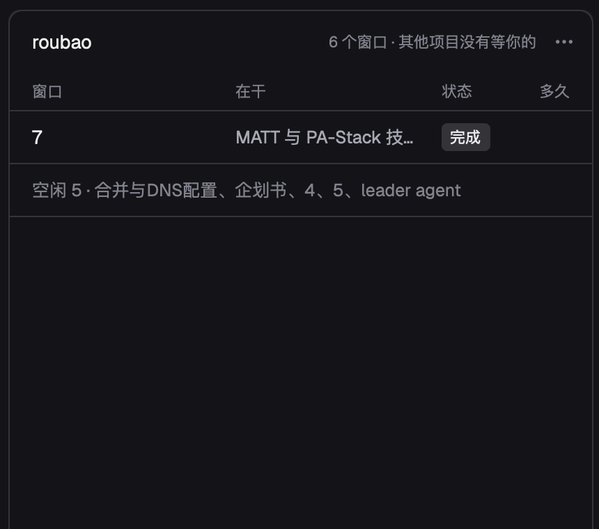

# Installation

The short path: paste this into Claude Code or Codex, in the project that should get a board.

```text
Install nawaban by following https://github.com/victorGPT/nawaban/blob/main/docs/install.md and create a board in this project.
```

The agent follows the next section. The sections after it are the same install by hand, and the details behind it.

## For the agent doing the install

Run these steps in order. Each one is safe to run again. Stop and tell the user if a step fails.

1. Check that `git` and `python3` exist and that `python3 --version` is 3.9 or newer.
2. Put nawaban at `~/nawaban`. If that directory exists and is a nawaban checkout, run `git -C ~/nawaban pull --ff-only`; otherwise run `git clone https://github.com/victorGPT/nawaban ~/nawaban`.
3. Install the plugin.
   - Claude Code: `claude plugin marketplace add ~/nawaban`, then `claude plugin install nawaban@nawaban`.
   - Codex: add the marketplace and plugin entries shown under [Plugin install](#plugin-install) to `~/.codex/config.toml` with `source = "<absolute path of ~/nawaban>"`, then run `codex plugin add nawaban@nawaban`. Also set `NAWABAN_OWNER` to a stable name in the environment Codex runs commands in ([Session identity](#session-identity)).
4. In the user's project, create the board: `python3 ~/nawaban/nawaban/cli.py init`. It prints the board path, or says the board already exists.
5. Tell the user three things: the board path from step 4, that the `nawaban` skill loads in a new session, so they should start one, and that they see the board in the Herdr panel, which they install by following [Herdr panel](#herdr-panel).

Optional, for a person who wants to type commands: add `nawaban() { python3 ~/nawaban/nawaban/cli.py "$@"; }` to their shell profile, only if they ask.

## Plugin install

The same checkout is a Claude Code plugin and a Codex plugin. It ships one skill, `nawaban`, and registers no hooks, so there is nothing to trust or approve beyond installing it.

- **Claude Code:** `claude plugin marketplace add /path/to/nawaban`, then `claude plugin install nawaban@nawaban`. For a one-off session, `claude --plugin-dir /path/to/nawaban` also works. With this directory marketplace, Claude Code reads the plugin from the checkout; start a new session after pulling. If you also develop nawaban, point the marketplace at a separate clone that only follows `main`, so branch switches and uncommitted edits stay out of your sessions ([release and update](release.md)).
- **From GitHub:** `claude plugin marketplace add victorGPT/nawaban`, then `claude plugin install nawaban@nawaban`. Claude Code updates the plugin only when `version` in `.claude-plugin/plugin.json` changes: run `claude plugin marketplace update nawaban && claude plugin update nawaban@nawaban`, then start a new session ([release and update](release.md)).
- **Codex:** add the checkout as a local marketplace in `~/.codex/config.toml`, then install it. Codex copies the plugin into its cache, so run `codex plugin add` again after pulling.

  ```toml
  [marketplaces.nawaban]
  source_type = "local"
  source = "/path/to/nawaban"

  [plugins."nawaban@nawaban"]
  enabled = true
  ```

  ```sh
  codex plugin add nawaban@nawaban
  ```

For a local checkout, clone `https://github.com/victorGPT/nawaban` and replace `/path/to/nawaban` with its absolute path. Private repositories require GitHub access.

## Run from a checkout

Set `NAWABAN_HOME` to this checkout and define the CLI in your shell (no package installation required):

```sh
export NAWABAN_HOME="$(pwd)"
nawaban() { python3 "$NAWABAN_HOME/nawaban/cli.py" "$@"; }
```

Run `nawaban init` in the project to create `.nawaban/nawaban.db`, then `nawaban list`. The CLI picks the board from an explicit `--db`, then `NAWABAN_DB`, then `.nawaban/nawaban.db` in the repository's main checkout (so linked worktrees share it), then the nearest `.nawaban/` above the current directory. Several projects can share one board: pass the same absolute `--db` everywhere; a new task's project defaults to its parent's, then to the repository holding the board. `nawaban backup` copies the board into `backups/` beside it.

## Session identity

Commands that write as someone (`claim`, `close`, `event`) take the identity from `CLAUDE_CODE_SESSION_ID`, which Claude Code sets in every session, then from `NAWABAN_OWNER`. Codex sets no session variable, so set `NAWABAN_OWNER` to a stable name in the environment Codex runs commands in; without either variable those commands refuse and say so.

## Herdr panel

The [Herdr](https://herdr.dev) app can show the board as a read-only panel beside your terminals. It shows the windows (agent terminals) of the focused space waiting on you, and what each leader and the workers it dispatched are doing on the board of the project that space is in; it runs `python3 ~/nawaban/nawaban/cli.py json ...` in the space's folder. So it needs the checkout at `~/nawaban` (step 2 above) and `python3`.

1. Copy the mod into Herdr. Copy rather than symlink: Herdr does not reload a symlinked mod when it changes. Run the same command again after pulling to update it.

   ```sh
   cp -R ~/nawaban/herdr/mods/nawaban-board ~/.config/herdr-app/mods/
   herdr-app check ~/.config/herdr-app/mods/nawaban-board
   ```

   The mod has `"place": "none"`, so it shows only where a layout puts it.

2. Add the panel to a layout you own. Herdr's shipped layouts are read-only; clone one first if needed: `herdr-app do layout.clone '{"name":"main","as":"my-layout"}'`. In `~/.config/herdr-app/layouts/<layout>.json`, find the row that holds the terminals (in clones of `main` it is the row with id `work-body`) and add this block as its last child, so it sits on the right:

   ```json
   {
     "id": "nawaban",
     "type": "block",
     "hidden": true,
     "size": { "px": 420 },
     "min": 360,
     "max": 720,
     "background": "background",
     "radius": 8,
     "content": { "mod": "nawaban-board" }
   }
   ```

   It starts hidden, at 420 px; drag its edge to resize it between 360 and 720 px. Extra width goes to the item titles; below 400 px a spec's progress segments are dropped. `background` and `radius` only paint the panel as a card; drop them if your layout has its own look.

3. Bind a key in `~/.config/herdr-app/keys.json`, in the section for that layout (create the section if it is missing):

   ```json
   "layout:<layout>": {
     "cmd-shift-j": "layout.toggle:nawaban"
   }
   ```

   Herdr does not use `cmd-shift-j` by default. On macOS a `ctrl-shift-j` binding did not toggle the panel while a terminal had focus (tested 2026-11-04 with Claude Code running in it); `cmd-shift-j` does. Avoid plain ctrl+letters such as `ctrl-k`: terminal programs need them. Without a key, `herdr-app do layout.toggle --id nawaban` opens and closes the panel.

Herdr applies both files within a second. A broken file is ignored, the last good version stays, and Herdr writes `~/.config/herdr-app/layout.error` or `keys.error`; `herdr-app status` lists the same problems under `errors`, which should be `[]`.



The panel shows one project, the one of the focused space. Top to bottom:

- **Header.** The project name; on the right, how many windows the space has and how many items wait on you in other projects.
- **Waiting.** "N 个窗口在等你", then one amber card per window waiting on you: the window, how long it has waited, the question, what it is working on, and "去窗口 →". A window waits on you when it holds a task whose latest `triage:` note is `triage: needs-info — 等你：<question>`, or when Herdr reports it blocked (the card says 在等你确认). A waiting task of this project in no window of this space still gets a card, without the button. When nothing waits, the headline and the cards are gone.
- **Leaders.** One group per leader (GLOSSARY: Leader, the author of a task's latest `dispatch:` note, else the session holding it): its window's name and "自己 n · 派出 m", the first line of the latest decision on its open items ("11-05 定：…"), then its items on a rail, numbered by when each was first claimed; unclaimed ones after, by creation. A spec is one item, with a segment per ticket in blocked-by order and done/total. Each item says its state on the right: 完成 09:10 (done items stay 24 hours), 在干 40 分钟 (held, its window working; the inner dot breathes), 停了 2 小时 (held, its window idle or closed), 还没动. Under a held item, 自己 or worker, its latest note (two lines; `coord:` notes skipped) and "去窗口 →" while the window is there; resting the pointer on the item shows the whole note. A leader with a stopped item comes first, then the one that moved last.
- **No task.** One last row with every window of the space that holds no open task and is not a card, whatever Herdr says it is doing: "没认领 2 · 部署（在干）、闲聊".

Clicking a card or an item goes to its window (`agent.focus`). The panel takes the keyboard when you click it or reach it with `pane.go`. Then ↑ and ↓ move the selection through the cards and items, Enter goes to the selected window, and Esc clears the selection; `pane.go` (or a click elsewhere) hands the keyboard back. Each of these is also a command, `nawaban-board.down`, `.up`, `.open`, `.back` and `.focus` (takes the keyboard), for a `keys.json` binding or `herdr-app do nawaban-board.open`; Herdr delivers them only while the panel is shown. The ⋯ menu switches the labels between Chinese and English.

The panel rereads the board when the board file changes, and when a window of the space comes, goes or changes state, not on a clock; it also rereads once a minute in case a change was missed.
